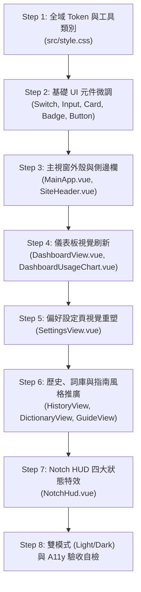

# TypeK UI 刷新規格映射指南：方案 D 繽紛少女風（Colourful Girly Pop）落地實作手冊

> **致實作者（小D / DeepSeek）**：  
> 本份規格手冊為 TypeK UI 刷新獲選方案 **Option D（繽紛少女風 / Colourful Girly Pop）** 映射至真實專案程式碼的唯一權威指南。  
> 基準設計稿請參閱：[`docs/demos/ui-refresh/option-d.html`](file:///Users/kevinkuo/Library/Mobile%20Documents/com~apple~CloudDocs/Documents/Github%20project/TypeK/docs/demos/ui-refresh/option-d.html) 以及設計評估報告 [`docs/demos/ui-refresh/proposal-cd.md`](file:///Users/kevinkuo/Library/Mobile%20Documents/com~apple~CloudDocs/Documents/Github%20project/TypeK/docs/demos/ui-refresh/proposal-cd.md)。  
> 依據專案規範（`.claude/rules/ui.md`），拍板 demo 視為規格的一部分，後續驗收將嚴格對照 demo 畫面與真實畫面（Light & Dark 雙模式）。請逐節閱讀並依建議步驟推進。

---

## 1. 全域 Token 與 CSS 定義（`src/style.css`）

TypeK 使用 Tailwind CSS v4 與 CSS 變數體系。所有色彩一律透過語意變數驅動，禁止在元件中硬編碼任意色值。

### 1.1 精確變數數值（Exact Token Values）

請將 [`src/style.css`](file:///Users/kevinkuo/Library/Mobile%20Documents/com~apple~CloudDocs/Documents/Github%20project/TypeK/src/style.css) 中的 `:root` 與 `.dark` 區塊更新為下列數值（包含 `--radius`、`--sidebar*`、`--chart-1..5` 以及自訂果凍陰影變數）：

```css
@theme inline {
  --radius-sm: calc(var(--radius) - 6px);
  --radius-md: calc(var(--radius) - 4px);
  --radius-lg: var(--radius);
  --radius-xl: calc(var(--radius) + 6px);
  --color-background: var(--background);
  --color-foreground: var(--foreground);
  --color-card: var(--card);
  --color-card-foreground: var(--card-foreground);
  --color-popover: var(--popover);
  --color-popover-foreground: var(--popover-foreground);
  --color-primary: var(--primary);
  --color-primary-foreground: var(--primary-foreground);
  --color-secondary: var(--secondary);
  --color-secondary-foreground: var(--secondary-foreground);
  --color-muted: var(--muted);
  --color-muted-foreground: var(--muted-foreground);
  --color-accent: var(--accent);
  --color-accent-foreground: var(--accent-foreground);
  --color-destructive: var(--destructive);
  --color-warning: var(--warning);
  --color-border: var(--border);
  --color-input: var(--input);
  --color-ring: var(--ring);
  --color-chart-1: var(--chart-1);
  --color-chart-2: var(--chart-2);
  --color-chart-3: var(--chart-3);
  --color-chart-4: var(--chart-4);
  --color-chart-5: var(--chart-5);
  --color-sidebar: var(--sidebar);
  --color-sidebar-foreground: var(--sidebar-foreground);
  --color-sidebar-primary: var(--sidebar-primary);
  --color-sidebar-primary-foreground: var(--sidebar-primary-foreground);
  --color-sidebar-accent: var(--sidebar-accent);
  --color-sidebar-accent-foreground: var(--sidebar-accent-foreground);
  --color-sidebar-border: var(--sidebar-border);
  --color-sidebar-ring: var(--sidebar-ring);
}

:root {
  /* 圓角：20px 飽滿親和大圓角（果凍氣泡美學） */
  --radius: 1.25rem;

  /* 淺色模式：草莓奶昔棉花糖色系 */
  --background: #fff6fa;              /* 棉花糖奶霜粉白 */
  --foreground: #3c1945;              /* 濃郁黑醋栗葡萄深紫（對比度 > 12:1） */
  --card: #ffffff;                    /* 果凍牛奶純白卡片 */
  --card-foreground: #3c1945;
  --popover: #ffffff;
  --popover-foreground: #3c1945;
  --primary: #ec4899;                 /* 亮麗熱情泡泡糖粉（Bubblegum Pink） */
  --primary-foreground: #ffffff;      /* 主按鈕純白文字 */
  --secondary: #fce7f3;               /* 草莓奶昔柔粉底色 */
  --secondary-foreground: #3c1945;
  --muted: #f5e8fc;                   /* 夢幻薰衣草柔霧底色 */
  --muted-foreground: #7d4d7f;        /* 柔和梅紫文字（對比度 > 5.2:1） */
  --accent: #fdf2f8;                  /* 櫻花仙氣淡粉選取高光 */
  --accent-foreground: #3c1945;
  --destructive: #f43f5e;             /* 多汁西瓜軟糖紅 */
  --warning: #f59e0b;                 /* 蜜糖檸檬金黃 */
  --border: #f0d1ea;                  /* 棉花糖粉紫柔邊線 */
  --input: #f0d1ea;                   /* 輸入框外框線 */
  --ring: #ec4899;                    /* 聚焦外環 */

  /* 五色糖果圖表色調 */
  --chart-1: #f472b6;                 /* 蜜桃草莓粉 */
  --chart-2: #c084fc;                 /* 夢幻薰衣草紫 */
  --chart-3: #38bdf8;                 /* 彈珠汽水天空藍 */
  --chart-4: #34d399;                 /* 清涼薄荷綠 */
  --chart-5: #facc15;                 /* 璀璨星星檸檬黃 */

  /* 側邊欄專屬色 */
  --sidebar: #fff0f7;                 /* 浪漫草莓牛奶冰淇淋側邊欄底色 */
  --sidebar-foreground: #3c1945;
  --sidebar-primary: #ec4899;
  --sidebar-primary-foreground: #ffffff;
  --sidebar-accent: #fce7f3;          /* 側邊欄項目選取膠囊底色 */
  --sidebar-accent-foreground: #2d1035;
  --sidebar-border: #f0d1ea;
  --sidebar-ring: #ec4899;

  /* 自訂裝飾與陰影變數 */
  --jelly-shadow: 0 8px 24px rgba(236, 72, 153, 0.12), 0 2px 6px rgba(168, 85, 247, 0.08);
  --jelly-shadow-hover: 0 12px 30px rgba(236, 72, 153, 0.22), 0 4px 10px rgba(168, 85, 247, 0.14);

  /* Notch HUD 色彩 */
  --notch-bg: #281232;                /* 奇幻莓果黑夜琉璃 Notch 外殼 */
  --notch-fg: #fdecf6;                /* 星光草莓米白 */
  --notch-fg-soft: rgba(253, 236, 246, 0.65);
}

.dark {
  /* 深色模式：魔法少女午夜星空黑曜深紫系 */
  --background: #150d22;              /* 魔法少女午夜星空黑曜深紫 */
  --foreground: #fdf2fe;              /* 璀璨星塵粉白（對比度 > 14:1） */
  --card: #221434;                    /* 晶瑩紫水晶果凍卡片底色 */
  --card-foreground: #fdf2fe;
  --popover: #221434;
  --popover-foreground: #fdf2fe;
  --primary: #f43f8e;                 /* 霓虹耀眼電光草莓粉 */
  --primary-foreground: #ffffff;
  --secondary: #2f1a45;               /* 深夜黑莓酒紅 */
  --secondary-foreground: #fdf2fe;
  --muted: #2f1a45;
  --muted-foreground: #c29fcf;        /* 薰衣草星塵粉紫文字（對比度 > 5.5:1） */
  --accent: #3d205a;                  /* 霓虹紫光薄霧選取底色 */
  --accent-foreground: #ffffff;
  --destructive: #fb7185;
  --warning: #fbbf24;
  --border: #4a286a;                  /* 霓虹微光柔邊線 */
  --input: #4a286a;
  --ring: #f43f8e;

  /* 五色糖果圖表色調（深色模式保持通透亮眼） */
  --chart-1: #f472b6;
  --chart-2: #c084fc;
  --chart-3: #38bdf8;
  --chart-4: #34d399;
  --chart-5: #fde047;

  /* 側邊欄專屬色 */
  --sidebar: #10091b;                 /* 浩瀚夜空黑曜紫 */
  --sidebar-foreground: #fdf2fe;
  --sidebar-primary: #f43f8e;
  --sidebar-primary-foreground: #ffffff;
  --sidebar-accent: #26123b;
  --sidebar-accent-foreground: #ffffff;
  --sidebar-border: #381c54;
  --sidebar-ring: #f43f8e;

  /* 自訂裝飾與陰影變數 */
  --jelly-shadow: 0 8px 24px rgba(0, 0, 0, 0.4), 0 0 15px rgba(244, 63, 142, 0.15);
  --jelly-shadow-hover: 0 12px 32px rgba(0, 0, 0, 0.5), 0 0 22px rgba(244, 63, 142, 0.28);

  /* Notch HUD 色彩 */
  --notch-bg: #12081d;
  --notch-fg: #fdf2fe;
  --notch-fg-soft: rgba(253, 242, 254, 0.6);
}
```

### 1.2 全域字體層級（Typography Hierarchy）

在 `src/style.css` 的 `@layer base` 中補充親和圓弧字體棧（優先調用系統圓體，無需外部網路下載字型）：

```css
@layer base {
  body {
    font-family: "SF Pro Rounded", "Avenir Next Rounded", "Arial Rounded MT Bold", -apple-system, BlinkMacSystemFont, "PingFang TC", "Noto Sans TC", sans-serif;
  }
}
```

### 1.3 全域 Utility 類別（Global Utility Classes）

將下列 CSS 規則加入 `src/style.css`，作為共用樣式工具：

```css
/* 1. 果凍晶透立體陰影 (Jelly Gloss Shadow) */
.shadow-jelly {
  box-shadow: var(--jelly-shadow);
  transition: box-shadow 0.2s cubic-bezier(0.34, 1.56, 0.64, 1), transform 0.2s cubic-bezier(0.34, 1.56, 0.64, 1);
}
.shadow-jelly:hover {
  box-shadow: var(--jelly-shadow-hover);
}

/* 2. 手帳立體貼紙徽章 (Die-cut Sticker Badge) */
.badge-sticker {
  display: inline-flex;
  align-items: center;
  gap: 0.25rem;
  padding: 0.15rem 0.625rem;
  border-radius: 9999px;
  font-size: 0.6875rem;
  font-weight: 700;
  background: linear-gradient(135deg, #fef08a, #fed7aa);
  color: #854d0e;
  border: 1.5px solid #ffffff;
  box-shadow: 0 2px 6px rgba(234, 179, 8, 0.25);
  transform: rotate(-1.5deg);
}

/* 3. 糖果果凍膠囊標籤 (Jelly Pill Badge) */
.badge-jelly {
  display: inline-flex;
  align-items: center;
  gap: 0.25rem;
  padding: 0.2rem 0.625rem;
  border-radius: 9999px;
  font-size: 0.6875rem;
  font-weight: 700;
  background: linear-gradient(135deg, var(--accent), var(--secondary));
  color: var(--primary);
  border: 1px solid var(--border);
}

/* 4. 彩虹漸變果凍進度條 (Rainbow Progress Track) */
.rainbow-track {
  width: 100%;
  height: 0.5rem;
  background: var(--muted);
  border-radius: 9999px;
  overflow: hidden;
}
.rainbow-fill {
  height: 100%;
  border-radius: 9999px;
  background: linear-gradient(90deg, #f472b6, #c084fc, #38bdf8);
  box-shadow: 0 0 8px rgba(244, 114, 182, 0.4);
  transition: width 0.4s cubic-bezier(0.34, 1.56, 0.64, 1);
}

/* 5. 夢幻彩虹微光畫布背景 (Dreamy Pastel Aura Background) */
.dreamy-aura-bg {
  background-image:
    radial-gradient(circle at 10% 20%, rgba(244, 114, 182, 0.08) 0%, transparent 40%),
    radial-gradient(circle at 90% 10%, rgba(192, 132, 252, 0.1) 0%, transparent 45%),
    radial-gradient(circle at 50% 85%, rgba(56, 189, 248, 0.07) 0%, transparent 50%);
  background-attachment: fixed;
}
```

---

## 2. 逐元件對照表（Component Mapping Table）

| Option-D Demo 元素 | 對應檔案 / 現行實作 | 具體修改內容（Classes / Props / DOM 調整） | 是否需新增 shadcn-vue primitive？ |
| :--- | :--- | :--- | :--- |
| **視窗標題列 (Titlebar)**<br>圓潤高光、微光邊框、SF Pro Rounded 標題 | [`src/MainApp.vue`](file:///Users/kevinkuo/Library/Mobile%20Documents/com~apple~CloudDocs/Documents/Github%20project/TypeK/src/MainApp.vue) L267-273<br>`data-tauri-drag-region` 容器 | 1. 容器 class 改為 `border-b border-sidebar-border bg-sidebar/90 backdrop-blur-md`<br>2. 標題文字改用 `text-foreground font-bold tracking-wide` 並加上圓體字型。<br>3. 保留現有 `TypeK` 字串（不寫死 Sweet Edition，避免更動 i18n/品牌文字）。 | **否**<br>純 Tailwind class |
| **側邊欄外殼 (Sidebar)**<br>草莓牛奶底色、柔和邊框 | [`src/MainApp.vue`](file:///Users/kevinkuo/Library/Mobile%20Documents/com~apple~CloudDocs/Documents/Github%20project/TypeK/src/MainApp.vue) L276<br>`<Sidebar>` | 1. 受全域 `--sidebar*` 驅動，自然呈現粉紫冰淇淋底色。<br>2. 側邊欄邊框調整為 `border-r border-sidebar-border`。<br>3. 內距微調，維持親和寬鬆比例。 | **否**<br>既有 `Sidebar` primitive |
| **側邊欄 Logo 區**<br>漸變粉紫圓角方塊與 App 名稱 | [`src/MainApp.vue`](file:///Users/kevinkuo/Library/Mobile%20Documents/com~apple~CloudDocs/Documents/Github%20project/TypeK/src/MainApp.vue) L277-280<br>`SidebarHeader` | 1. 將現有「言」Logo 圖標外包裹一層粉紫漸變圓角底框：`w-8 h-8 rounded-xl bg-gradient-to-br from-chart-1 to-chart-2 flex items-center justify-center shadow-md p-1`<br>2. Logo 文字改用 `font-extrabold text-sidebar-foreground`。 | **否**<br>純 DOM 樣式包裹 |
| **側邊欄導航項 (Nav Items)**<br>全圓角膠囊 (Pill)、懸浮位移 | [`src/MainApp.vue`](file:///Users/kevinkuo/Library/Mobile%20Documents/com~apple~CloudDocs/Documents/Github%20project/TypeK/src/MainApp.vue) L285-296<br>`SidebarMenuButton` | 1. 在 `SidebarMenuButton` 傳入 `class="rounded-full transition-all duration-200 hover:translate-x-1"`。<br>2. 保持 `<SidebarMenuButton as-child :is-active="...">` 結構。<br>3. 選中狀態高亮：當 `:is-active` 為真時套用 `bg-gradient-to-r from-card to-accent text-primary font-bold shadow-sm border border-border`。<br>4. 圖標與文字顏色隨 active 自動高亮粉色。 | **否**<br>透過 class 覆蓋樣式 |
| **側邊欄頁尾狀態與更新 (Footer)**<br>待命狀態膠囊徽章與更新控制 | [`src/MainApp.vue`](file:///Users/kevinkuo/Library/Mobile%20Documents/com~apple~CloudDocs/Documents/Github%20project/TypeK/src/MainApp.vue) L300-333<br>`SidebarFooter` | 1. 將版本號與更新按鈕以柔和膠囊外框包裹。<br>2. 準備安裝狀態提示保留既有邏輯，樣式套用 `rounded-full bg-primary/15 text-primary border border-primary/20`。<br>3. 按鈕套用 `rounded-full` 膠囊造型。 | **否**<br>既有 `Button` 樣式調整 |
| **頁面標題列 (SiteHeader)**<br>通透頂部導航欄 | [`src/components/SiteHeader.vue`](file:///Users/kevinkuo/Library/Mobile%20Documents/com~apple~CloudDocs/Documents/Github%20project/TypeK/src/components/SiteHeader.vue) L8-14 | 1. Header 樣式改為 `border-b border-border bg-background/80 backdrop-blur-md px-6 h-14`<br>2. 標題 `h1` 改為 `text-lg font-extrabold text-foreground tracking-tight`。 | **否**<br>純 Tailwind class |
| **統計數據卡片 (Stats Cards)**<br>果凍陰影、大圓角、等寬數字排印 | [`src/views/DashboardView.vue`](file:///Users/kevinkuo/Library/Mobile%20Documents/com~apple~CloudDocs/Documents/Github%20project/TypeK/src/views/DashboardView.vue) L187-241<br>6 張 `<Card>` | 1. 在每張 `<Card>` 加上 `shadow-jelly rounded-[var(--radius)] border-border bg-card transition-all duration-200 hover:-translate-y-0.5`<br>2. 數值段落 `<p>` 加上 `font-extrabold tabular-nums tracking-tight text-3xl text-foreground`<br>3. 單位加上 `text-primary text-sm font-semibold ml-1`<br>4. CardDescription 加上 `font-bold text-muted-foreground`。 | **否**<br>既有 `Card` primitive |
| **今日額度進度條 (Daily Quota Bar)**<br>彩虹漸變果凍進度條 | [`src/views/DashboardView.vue`](file:///Users/kevinkuo/Library/Mobile%20Documents/com~apple~CloudDocs/Documents/Github%20project/TypeK/src/views/DashboardView.vue) L259-265 | 1. 將外層槽條改為 `rainbow-track`。<br>2. 內部進度條改為 `rainbow-fill`（正常額度套用 `bg-gradient-to-r from-chart-1 via-chart-2 to-chart-3`；若額度低於 20% 則優雅過渡為警告琥珀色，兼顧功能性）。 | **否**<br>全域 utility class |
| **7 日使用趨勢圖 (Usage Chart)**<br>糖果色光暈與趨勢圖展臺 | [`src/components/DashboardUsageChart.vue`](file:///Users/kevinkuo/Library/Mobile%20Documents/com~apple~CloudDocs/Documents/Github%20project/TypeK/src/components/DashboardUsageChart.vue) L75-100 | 1. 保持 Unovis 面積與折線圖結構以兼顧資料連續性。<br>2. 更新 SVG `<linearGradient id="fillCount">`：漸變起點改為 `var(--chart-1)`（草莓粉），中段融入 `var(--chart-2)`（薰衣草紫），底層平滑淡出至 transparent。<br>3. 折線 `lineColor` 綁定 `var(--chart-1)`，寬度設為 `2.5px`，拐點呈現柔光感。<br>4. 圖表容器加上 `rounded-[var(--radius)] p-2`。 | **否**<br>SVG 漸變與 CSS Token 調整 |
| **最近轉錄記錄列 (Recent Items)**<br>圓潤卡片項與果凍徽章 | [`src/views/DashboardView.vue`](file:///Users/kevinkuo/Library/Mobile%20Documents/com~apple~CloudDocs/Documents/Github%20project/TypeK/src/views/DashboardView.vue) L385-407 | 1. 每筆記錄按鈕改為 `rounded-2xl border border-border bg-card hover:bg-accent/60 transition-all duration-150 hover:translate-x-1 p-3.5`<br>2. AI 精修標籤由原本硬編碼 `bg-emerald-500/20 text-emerald-400` 改用 `<Badge class="badge-jelly">`。<br>3. 時間戳記與內文保持截斷與等寬排版。 | **否**<br>既有 `Badge` + class |
| **AI 平臺與模型選擇卡片**<br>果凍浮雕卡片、選取外光暈 | [`src/views/SettingsView.vue`](file:///Users/kevinkuo/Library/Mobile%20Documents/com~apple~CloudDocs/Documents/Github%20project/TypeK/src/views/SettingsView.vue) L1455-1560<br>Provider 選擇區 | 1. 若為按鈕或 RadioGroup，改用果凍卡片網格佈局：`grid grid-cols-2 sm:grid-cols-4 gap-3`<br>2. 選中狀態套用 `border-2 border-primary bg-gradient-to-br from-card to-accent shadow-jelly text-primary font-bold`<br>3. 未選中狀態套用 `border border-border bg-card hover:border-primary/50 hover:scale-[1.02]`。 | **否**<br>既有 `RadioGroup` 或 `Button` |
| **金鑰與文字輸入框 (Input)**<br>全圓角膠囊輸入框與高光聚焦環 | [`src/views/SettingsView.vue`](file:///Users/kevinkuo/Library/Mobile%20Documents/com~apple~CloudDocs/Documents/Github%20project/TypeK/src/views/SettingsView.vue) L1283-1290 等<br>`Input` 元件 | 1. 在 `Input` 外觀傳入 `rounded-full px-4 border-input focus-visible:ring-primary/40 focus-visible:ring-[3px]`。<br>2. 密碼顯隱切換按鈕維持在右側，同為 `rounded-full`。 | **否**<br>既有 `Input` primitive |
| **快捷鍵展示與錄製 (Hotkey)**<br>手帳手撕感按鍵膠囊 | [`src/views/SettingsView.vue`](file:///Users/kevinkuo/Library/Mobile%20Documents/com~apple~CloudDocs/Documents/Github%20project/TypeK/src/views/SettingsView.vue) L1120-1135 | 1. 熱鍵標籤套用 `badge-jelly px-3.5 py-1.5 text-xs font-mono font-bold tracking-wider`<br>2. 錄製按鈕套用 `<Button size="sm" class="rounded-full">`，錄製中維持呼吸燈動畫。 | **否**<br>既有 `Button` + class |
| **Switch 開關元件**<br>粉紫漸變果凍滑塊、彈性阻尼感 | [`src/components/ui/switch/Switch.vue`](file:///Users/kevinkuo/Library/Mobile%20Documents/com~apple~CloudDocs/Documents/Github%20project/TypeK/src/components/ui/switch/Switch.vue) L26-36 | 1. `SwitchRoot`：開啟狀態改為 `data-[state=checked]:bg-gradient-to-r data-[state=checked]:from-primary data-[state=checked]:to-[#c084fc] shadow-sm`<br>2. `SwitchThumb`：滑塊保持純白高光 `bg-white shadow-md rounded-full`<br>3. 寬度維持標準 44px–46px，滑動手感 Q 彈。 | **否**<br>微調既有 `Switch.vue` 內部 class |
| **上下文感知與隱私守護卡片**<br>手帳安全協議專屬底盒 | [`src/views/SettingsView.vue`](file:///Users/kevinkuo/Library/Mobile%20Documents/com~apple~CloudDocs/Documents/Github%20project/TypeK/src/views/SettingsView.vue) L1809-1845 | 1. 上下文感知開關行保持標準 `<Switch>` 與 `<Label>`。<br>2. 隱私承諾段落以甜心粉紫底盒包裹：`mt-3 p-3.5 bg-secondary/50 border border-border rounded-[var(--radius)] text-xs leading-relaxed text-foreground`。 | **否**<br>純 CSS 樣式包裹 |
| **轉錄歷史頁 (HistoryView)**<br>風格推廣：手帳搜尋條與記錄折疊項 | [`src/views/HistoryView.vue`](file:///Users/kevinkuo/Library/Mobile%20Documents/com~apple~CloudDocs/Documents/Github%20project/TypeK/src/views/HistoryView.vue) L227-320 | 1. 搜尋輸入框加上 `rounded-full pl-9 border-input shadow-xs`<br>2. 記錄列表外層 `<Card>` 套用 `rounded-[var(--radius)] shadow-jelly border-border`<br>3. 播放、複製按鈕改為圓形小按鈕 `rounded-full size-8`<br>4. AI 精修 Badge 改為 `badge-jelly`。 | **否**<br>純 Tailwind class |
| **自訂詞庫頁 (DictionaryView)**<br>風格推廣：手帳表格與操作膠囊 | [`src/views/DictionaryView.vue`](file:///Users/kevinkuo/Library/Mobile%20Documents/com~apple~CloudDocs/Documents/Github%20project/TypeK/src/views/DictionaryView.vue) L202-395 | 1. 匯出/匯入/新增詞彙按鈕全面改為 `rounded-full`<br>2. 詞庫表格 `TableRow` 加上 `hover:bg-accent/40 rounded-xl transition-colors`<br>3. 詞彙權重 Badge 套用糖果色變體（高權重粉色、次權重薰衣草紫）。 | **否**<br>純 Tailwind class |
| **使用指南頁 (FeatureGuideView)**<br>風格推廣：魔法卡片展臺 | [`src/views/FeatureGuideView.vue`](file:///Users/kevinkuo/Library/Mobile%20Documents/com~apple~CloudDocs/Documents/Github%20project/TypeK/src/views/FeatureGuideView.vue) L36-54 | 1. 每張功能指南 `<Card>` 加上 `shadow-jelly rounded-[var(--radius)] hover:scale-[1.01] transition-transform`<br>2. 功能圖標外層加上淡粉紫圓角背景：`p-1.5 rounded-lg bg-secondary text-primary size-7`。 | **否**<br>純 Tailwind class |
| **HUD 外殼 (NotchHud Shell)**<br>奇幻莓果黑夜琉璃、星芒光暈 | [`src/components/NotchHud.vue`](file:///Users/kevinkuo/Library/Mobile%20Documents/com~apple~CloudDocs/Documents/Github%20project/TypeK/src/components/NotchHud.vue) L476-525 | 1. `.notch-hud` 背景使用 `var(--notch-bg)`，邊框加上 `1px solid rgba(244, 114, 182, 0.3)`，外陰影升級為莓果粉光暈：`drop-shadow(0 8px 24px rgba(236, 72, 153, 0.35))`<br>2. 兩側邊緣新增閃爍星芒點綴（見 HUD 專節）。 | **否**<br>CSS 修改 |
| **HUD 錄音中狀態 (Recording)**<br>六色彩虹軟糖波形、跳動愛心 | [`src/components/NotchHud.vue`](file:///Users/kevinkuo/Library/Mobile%20Documents/com~apple~CloudDocs/Documents/Github%20project/TypeK/src/components/NotchHud.vue) L408-416, L555-577 | 1. 將 6 根波形條賦予 6 色糖果背景（`#f472b6`, `#fbbf24`, `#34d399`, `#38bdf8`, `#c084fc`, `#f43f8e`），邊角為全圓角。<br>2. 左側加入跳動愛心圖標（使用 Lucide `Heart` 搭配 CSS 心跳 keyframe）。<br>3. 右側計時器套用 `badge-jelly` 膠囊框。 | **否**<br>CSS + Lucide Icon |
| **HUD 整理中狀態 (Processing)**<br>魔法小精靈光塵脈衝 | [`src/components/NotchHud.vue`](file:///Users/kevinkuo/Library/Mobile%20Documents/com~apple~CloudDocs/Documents/Github%20project/TypeK/src/components/NotchHud.vue) L579-615 | 1. 整理中狀態的 sliding dots 融入旋轉魔法星芒（使用 Lucide `Sparkles` 搭配 `spinMagic` 關鍵影格）。<br>2. 提示文字賦予璀璨星塵淡粉光澤。 | **否**<br>CSS + Lucide Icon |
| **HUD 已貼上狀態 (Success)**<br>草莓薄荷蝴蝶結勳章 | [`src/components/NotchHud.vue`](file:///Users/kevinkuo/Library/Mobile%20Documents/com~apple~CloudDocs/Documents/Github%20project/TypeK/src/components/NotchHud.vue) L418-432, L649-671 | 1. 勾選圖標改為薄荷綠漸變圓形勳章（`bg-gradient-to-br from-[#34d399] to-[#10b981]`）。<br>2. 成功外光暈改為薄荷微光混搭草莓粉光暈。 | **否**<br>CSS 樣式調整 |
| **HUD 錯誤狀態 (Error)**<br>多汁草莓泡泡警示、重新施法按鈕 | [`src/components/NotchHud.vue`](file:///Users/kevinkuo/Library/Mobile%20Documents/com~apple~CloudDocs/Documents/Github%20project/TypeK/src/components/NotchHud.vue) L456-460, L838-876 | 1. 錯誤震顫保持，錯誤文字採用西瓜軟糖粉紅 `#ffe4e6`。<br>2. 重試按鈕改為糖果膠囊按鈕：`bg-gradient-to-r from-destructive to-pink-600 text-white rounded-full px-2.5 py-0.5 text-xs font-bold shadow-sm`。 | **否**<br>CSS 樣式調整 |

---

## 3. 不能照搬的地方（反模式阻斷與對齊專案守則）

Demo 為靜態展示原型，部分手法與 TypeK 專案規範存在衝突。實作時**嚴格禁止直接拷貝**以下項目，必須依右側方案轉換：

### 3.1 嚴禁在 Vue 檔案中硬編碼任意色彩（No Raw Tailwind Colors）
- ❌ **Demo 手法**：散落使用 `bg-[#ec4899]`、`color: #c084fc`、`border: 1.5px solid #f0d1ea`。
- ✅ **專案規則**：所有樣式必須使用 Tailwind 語意類別（如 `bg-primary`、`bg-card`、`text-foreground`、`border-border`）或引用 `var(--chart-1..5)`。任何特殊的漸變或光暈，必須收納至 `src/style.css` 的工具類別（如 `.shadow-jelly`、`.badge-jelly`、`.rainbow-fill`），確保 Light / Dark 模式一處切換全局響應。

### 3.2 嚴禁手寫 HTML 控制項替代品（No Custom Control Alternatives）
- ❌ **Demo 手法**：手寫 `<div class="switch-ui" onclick="...">`、原生 `<button class="btn">`、手寫 `<input class="input-box">`。
- ✅ **專案規則**：嚴格使用專案內已安裝的 shadcn-vue 元件：
  - 開關一律使用 `<Switch :model-value="..." @update:model-value="..." />`。
  - 按鈕一律使用 `<Button variant="..." size="...">`。
  - 輸入框一律使用 `<Input />`，並確保 `<Label for="id">` 與 `id` 配對完整以符合無障礙標準。
  - 下拉選單一律使用 `<Select>`，禁止手寫原生 `<select>`。

### 3.3 圖標唯一標準：`lucide-vue-next`（No Tabler, No Raw SVGs）
- ❌ **Demo 手法**：手寫 SVG 路徑（部分引用自非標準庫）或手繪向量。
- ✅ **專案規則**：全 repo 唯一允許使用 `lucide-vue-next`。
  - 愛心：`import { Heart } from "lucide-vue-next"`（錄音中）。
  - 魔法星芒：`import { Sparkles } from "lucide-vue-next"`（整理中）。
  - 勾選：`import { Check } from "lucide-vue-next"`（已貼上）。
  - 重試：`import { RotateCcw } from "lucide-vue-next"`（錯誤重試）。
  - 禁止使用 `@tabler/icons-vue`，亦禁止散落大段手寫 SVG。

### 3.4 嚴禁在 UI 介面文字中強塞 Emoji（Preserve Wording & Accessibility）
- ❌ **Demo 手法**：在正文硬編碼「語音整理平臺 💖」、「省下來喝 10 杯草莓奶茶 🍓」、「小精靈魔法潤飾中... 🪄」。
- ✅ **專案規則**：**嚴格保留所有現有 UI 文案（禁止變更業務文案與 i18n 鍵值）**。
  - 業務文字一律使用 `$t(...)`。
  - 少女風的甜美靈魂透過**排版色彩、果凍陰影、20px 圓角、彩虹波形與精緻的 Lucide 圖標**來傳達，不可修改繁體中文、簡體中文、英文等 5 語系字典檔案中的實際說明字串。
  - 僅允許在無障礙標記為裝飾性的圖標插槽放置微光星芒。

### 3.5 動畫必須尊重 `prefers-reduced-motion`（A11y Motion Compliance）
- ❌ **Demo 手法**：無限迴圈的心跳 `heartBeat`、彩虹柱 `candyBounce` 與小精靈旋轉 `spinMagic`。
- ✅ **專案規則**：在 `src/style.css` 結尾必須宣告降低動效媒體查詢，當使用者系統開啟「減少動態效果」時自動退回靜態高對比呈現：
```css
@media (prefers-reduced-motion: reduce) {
  .shadow-jelly,
  .btn,
  .wave-candy-bar,
  .magic-star,
  .heart-pulse {
    animation: none !important;
    transition: none !important;
    transform: none !important;
  }
}
```

---

## 4. 驗收清單（Acceptance Checklist: Demo vs Real Screens）

驗收時將啟動真實應用，分別在 **淺色模式 (Light)** 與 **深色模式 (Dark)** 下與 `docs/demos/ui-refresh/option-d.html` 進行像素與風格級對照。

### 4.1 全域與主外殼（Main Shell & Navigation）
- [ ] **圓角一致性**：所有卡片、對話框、選單均呈現飽滿柔和的 20px 圓角（`--radius: 1.25rem`），按鈕與標籤為全圓角膠囊（Pill）。
- [ ] **淺色畫布氛圍**：背景為柔和棉花糖奶霜粉白（`#fff6fa`），具備漫射彩虹微光感，非死白。本文文字對比度 ≥ 12:1，清晰深邃。
- [ ] **深色畫布氛圍**：背景切換為魔法少女午夜星空深紫（`#150d22`），卡片為晶瑩紫水晶果凍黑紫（`#221434`），文字為璀璨星塵粉白，護眼且通透。
- [ ] **側邊欄導航**：選中項呈現粉紫漸變全圓角膠囊，圖標高亮粉色，懸浮時帶有柔順的向右微位移（`translate-x-1`）。
- [ ] **標題列**：固定頂部拖曳列與側邊欄色彩無縫銜接，字體呈現親和圓體質感。

### 4.2 儀表板頁面（DashboardView）
- [ ] **6 格統計卡片**：每張卡片具備雙層果凍微光陰影（`--jelly-shadow`），滑鼠懸浮時呈現柔和浮起效果。
- [ ] **等寬數值排印**：數字採用 `tabular-nums`，字級飽滿（28px–30px），單位文字高亮為主題草莓粉。
- [ ] **今日額度進度條**：呈現三色果凍彩虹漸變（蜜桃粉 → 薰衣草紫 → 天空藍），進度槽為全圓角。
- [ ] **使用趨勢圖**：Unovis 漸變層與折線呈現通透蜜桃草莓粉光暈，無生硬毛刺或軸線截斷。
- [ ] **最近轉錄項目**：歷史記錄以圓角膠囊列排布，AI 精修徽章呈現晶透果凍質感。

### 4.3 偏好設定頁面（SettingsView）
- [ ] **AI 平臺選擇**：選中平臺卡片外圈呈現草莓粉高光聚焦環與淺粉底色，未選中項邊框柔和。
- [ ] **金鑰與文字輸入框**：輸入框為全圓角膠囊造型，Focus 聚焦環為草莓粉柔光。
- [ ] **快捷鍵與錄製**：熱鍵以手帳果凍標籤呈現，錄製按鈕造型圓潤。
- [ ] **Switch 開關**：開啟狀態呈現粉紫彩虹漸變，滑動阻尼手感滑順，關閉狀態為柔和淡霧灰紫。
- [ ] **隱私守護區塊**：上下文感知下方呈現淡粉紫手帳專屬底盒，邊框精緻。

### 4.4 轉錄歷史、自訂詞庫與指南（History, Dictionary & Guide）
- [ ] **搜尋框與動作按鈕**：全數呈現全圓角膠囊外觀，聚焦色彩統一。
- [ ] **表格細節**：詞庫表格行選取為淡淡櫻花高光，權重 Badge 呈現雙色糖果層次。
- [ ] **使用指南卡片**：卡片排版圓潤，圖標具備粉紫微底座，閱讀節奏舒適。

### 4.5 Notch HUD 實體狀態（NotchHud.vue）
- [ ] **外殼造型**：深莓黑夜琉璃外殼貼合螢幕頂部缺口，邊緣具備草莓粉氛圍柔光與微星芒點綴。
- [ ] **錄音中狀態**：中央 6 根波形條呈現彩虹軟糖 6 色分段，隨即時音量彈跳起伏；左側愛心輕柔律動；右側計時器數字清晰。
- [ ] **整理中狀態**：魔法星芒（Sparkles）平滑旋轉，傳遞精靈潤飾意象。
- [ ] **已貼上狀態**：薄荷綠漸變勳章平滑滑入，伴隨柔和光澤與完成時間。
- [ ] **錯誤狀態**：紅色多汁草莓泡泡提示與「重新施法」全圓角膠囊按鈕，具備晃動回饋。
- [ ] **動效無障礙**：在系統開啟減少動態效果時，無過度閃爍或強烈晃動。

---

## 5. 實作順序建議（Step-by-Step Implementation Roadmap）

為了確保每一步驟皆可獨立建構驗證、避免大規模改動引發型別或樣式回歸，建議小D依下列順序推進：



### 步驟 1：全域 Token 與基礎樣式落地（`src/style.css`）
- 將第 1 節的 CSS 變數（`:root` 與 `.dark`）寫入 [`src/style.css`](file:///Users/kevinkuo/Library/Mobile%20Documents/com~apple~CloudDocs/Documents/Github%20project/TypeK/src/style.css)。
- 寫入字體層級、`.shadow-jelly`、`.badge-jelly`、`.rainbow-track`、`.rainbow-fill` 等通用工具類別。
- 驗證：確認全域底色、字體已平滑生效，無 CSS 語法錯誤。

### 步驟 2：核心 shadcn-vue 元件微調
- 檢查 [`src/components/ui/switch/Switch.vue`](file:///Users/kevinkuo/Library/Mobile%20Documents/com~apple~CloudDocs/Documents/Github%20project/TypeK/src/components/ui/switch/Switch.vue)：將 checked 狀態背景改為粉紫漸變。
- 檢查 [`src/components/ui/card/Card.vue`](file:///Users/kevinkuo/Library/Mobile%20Documents/com~apple~CloudDocs/Documents/Github%20project/TypeK/src/components/ui/card/Card.vue)：確認已繼承 `rounded-[var(--radius)]` 與果凍陰影。
- 檢查 [`src/components/ui/button/index.ts`](file:///Users/kevinkuo/Library/Mobile%20Documents/com~apple~CloudDocs/Documents/Github%20project/TypeK/src/components/ui/button/index.ts)：確保膠囊尺寸與圓角支援良好。

### 步驟 3：主視窗外殼與側邊欄（`MainApp.vue` & `SiteHeader.vue`）
- 在 [`src/MainApp.vue`](file:///Users/kevinkuo/Library/Mobile%20Documents/com~apple~CloudDocs/Documents/Github%20project/TypeK/src/MainApp.vue) 中更新 Titlebar 與 SidebarHeader 的漸變圖標底盒。
- 調整 `navItems` 連結樣式為全圓角膠囊，Active 狀態套用高光發光邊框。
- 調整 [`src/components/SiteHeader.vue`](file:///Users/kevinkuo/Library/Mobile%20Documents/com~apple~CloudDocs/Documents/Github%20project/TypeK/src/components/SiteHeader.vue) 的背景模糊與字級。

### 步驟 4：儀表板重塑（`DashboardView.vue` & `DashboardUsageChart.vue`）
- 在 [`src/views/DashboardView.vue`](file:///Users/kevinkuo/Library/Mobile%20Documents/com~apple~CloudDocs/Documents/Github%20project/TypeK/src/views/DashboardView.vue) 中升級 6 格統計卡片（果凍陰影、等寬數字）。
- 升級今日額度條為彩虹漸變果凍條。
- 在 [`src/components/DashboardUsageChart.vue`](file:///Users/kevinkuo/Library/Mobile%20Documents/com~apple~CloudDocs/Documents/Github%20project/TypeK/src/components/DashboardUsageChart.vue) 中將 Unovis 漸變升級為草莓粉紫霓虹漸變。
- 最近記錄項套用圓角卡片與 `badge-jelly`。

### 步驟 5：偏好設定頁（`SettingsView.vue`）
- 在 [`src/views/SettingsView.vue`](file:///Users/kevinkuo/Library/Mobile%20Documents/com~apple~CloudDocs/Documents/Github%20project/TypeK/src/views/SettingsView.vue) 調整各設定區塊 Card 圓角與間距。
- 更新 Provider 選擇卡片、熱鍵展示 Badge 與 Input 全圓角樣式。
- 將上下文感知下方提示升級為粉紫手帳專屬底盒。

### 步驟 6：風格推廣至其他次要視圖（`HistoryView`, `DictionaryView`, `GuideView`）
- 調整 [`src/views/HistoryView.vue`](file:///Users/kevinkuo/Library/Mobile%20Documents/com~apple~CloudDocs/Documents/Github%20project/TypeK/src/views/HistoryView.vue) 的搜尋框與卡片清單。
- 調整 [`src/views/DictionaryView.vue`](file:///Users/kevinkuo/Library/Mobile%20Documents/com~apple~CloudDocs/Documents/Github%20project/TypeK/src/views/DictionaryView.vue) 的表格行高光與操作膠囊按鈕。
- 調整 [`src/views/FeatureGuideView.vue`](file:///Users/kevinkuo/Library/Mobile%20Documents/com~apple~CloudDocs/Documents/Github%20project/TypeK/src/views/FeatureGuideView.vue) 的指南展示卡片。

### 步驟 7：Notch HUD 特效與四狀態落地（`NotchHud.vue`）
- 在 [`src/components/NotchHud.vue`](file:///Users/kevinkuo/Library/Mobile%20Documents/com~apple~CloudDocs/Documents/Github%20project/TypeK/src/components/NotchHud.vue) 更新黑夜莓果琉璃背景與微粉外發光。
- 替 6 根動態波形條賦予 6 色彩虹軟糖色值，加入跳動愛心。
- 整理中注入旋轉星芒動效，已貼上狀態套用薄荷綠漸變圓形勳章，錯誤狀態套用粉紅草莓泡泡與重試膠囊按鈕。

### 步驟 8：完整驗收自檢
- 切換淺色與深色外觀，核對第 4 節所有驗收 Checkbox。
- 驗證 `prefers-reduced-motion` 行為正常。
- 執行 `pnpm build` 與 `npx vue-tsc --noEmit` 確保 100% 通過型別與打包檢查。

---

> **小A（三師姊）溫馨提醒**：  
> 少女風的精髓在於「**甜美有活力，但骨子裡專業嚴謹**」。文字對比度與無障礙標準絕對不可打折，業務文案與 IPC 邏輯一概嚴格保留。祝實作順利，期待看到閃閃發亮的 TypeK！✨
