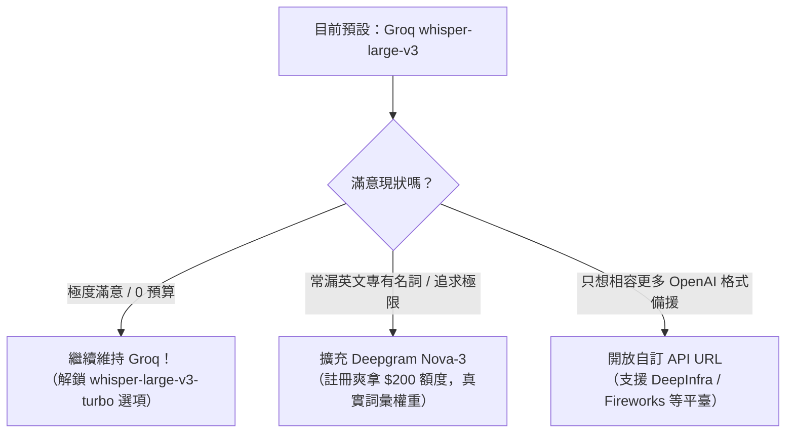

# TypeK 語音轉錄（ASR）引擎評估與選型建議報告

> 報告撰寫者：小 A（峨嵋派三師姊 · Antigravity）✨  
> 查核日期：2026-10-26  
> 核心立場：**Ponytail Senior Dev Mode（極簡懶人工程師哲學）** —— 最好的程式碼就是不用寫的程式碼。能靠現有架構白嫖且效果拔群的，先不要沒事重造輪子；但若要開付費外掛，每一分錢都要花在刀口上！

---

## 摘要與核心結論（TL;DR）

Kevin 提問：「目前語音轉錄還是 Groq。你問一下小 C 和小 A 的建議，目前市面有沒有更好的免費選擇？另外假設付費的話，有更好的選擇嗎？」

小 A 爬梳了 2026 年當前主流雲端 ASR、端側本機方案、以及各家 API 規格與價格，結論一句話總結：

1. **免費領域：Groq 目前依然是神，市面上沒有任何全方位能「擊敗」它的免費選擇。**
   - Groq 提供每天高達 **28,800 秒（8 小時）**的免費音訊轉錄額度，延遲僅 **300ms ~ 700ms**（全球最快），且完全不吃 Kevin 吃緊的本地硬碟空間。
   - 唯一的免費威脅是 **Microsoft Azure Speech（F0 方案）**，每月免費 5 小時，臺灣華語 + 英文混雜精準度極高，但超過 5 小時就要收費。
2. **端側本機（On-device）：目前「先不要」！**
   - Kevin 的 Mac 磁碟空間非常緊繃。本機 Whisper 要達到可用的中英混雜水準，至少需要 `large-v3-turbo`（~1.6 GB）或 `large-v3`（~3.1 GB）權重檔，外加推理時吃 2~4 GB 記憶體。
   - 更致命的是 Windows 跨平臺相容性：Windows 使用者若無 NVIDIA 獨顯，CPU 跑 10 秒音訊可能卡 8~20 秒，完全毀掉 TypeK「放開即貼上」的爽快感。
   - Apple 原生 `SFSpeechRecognizer` 雖然 0 磁碟負擔，但無法跨平臺（Windows 沒得用）、中英夾雜時常音譯翻車，且無法注入自訂辭典。
3. **付費領域：若追求極致中英混雜與專有名詞精準度，首選推薦 Deepgram Nova-3 與字節跳動 BytePlus。**
   - **首選推薦：Deepgram Nova-3（預錄 $0.26 / 小時，註冊送 $200 額度）**。具備真正的關鍵字權重增強（Keyterm Boosting）、原生支援臺灣繁體（`zh-TW`）、多語混雜優化，延遲僅 200~400ms。
   - **華語天花板：BytePlus Seed Speech / 火山引擎豆包語音（約 $0.12 ~ $0.17 / 小時）**。日常臺灣腔 + 各種 GitHub/開發英文術語混雜辨識力居地表最強梯隊，東南亞語系（泰、越）極穩。
4. **架構最小變更建議**：
   - 保持 Groq 為預設值；
   - 在 Rust 後端將 API Base URL 與模型名稱開放設定，讓 TypeK 零成本相容所有 OpenAI 規範的 ASR 平臺（如 DeepInfra、Fireworks、自建端點）；
   - 若要新增非 OpenAI 規範的付費王者（如 Deepgram），只需增加一個單純的 Binary POST 請求分支，工時約半天至 1 天。

---

## 評估維度與 TypeK 專屬場景特點

在幫 TypeK 選型時，不能拿一般的長語音逐字稿標準來套，必須鎖定 TypeK 的關鍵場景：

| 維度 | TypeK 的真實需求與約束 |
| :--- | :--- |
| **互動型態** | **Hold-to-talk（按住說話、放手貼上）**：音訊長度極短（3 秒到 1 分鐘），極度依賴低延遲。 |
| **延遲敏感度** | **使用者放開按鍵後正在乾等**！ASR 耗時超過 1.5 秒就會產生明顯停滯感。理想是 300~600ms。 |
| **語言特徵** | **臺灣華語（zh-TW）為主 + 高密度英文術語混雜（Code-switching）**（例如：「把這個 PR merge 掉」、「開個 meeting sync 一下」、「這個 bug 很 tricky」）。兼顧 zh-CN、en、ja、ko、vi、th。 |
| **辭典需求** | TypeK 有使用者自訂詞庫（`Important Vocabulary`），需要能注入關鍵字偏置。 |
| **二階段架構** | **TypeK 後面有接 LLM（預設 Gemini 3.1 Flash-Lite）做潤飾整理**。這意味著 ASR 本身不需要完美的標點或修飾，但**音素必須精準、不能漏英文詞、不能吞字、且背景靜音時不能產生無中生有的幻覺**。 |
| **硬體約束** | **Kevin 電腦磁碟空間緊繃**；且 TypeK 為 macOS + Windows 跨平臺桌面軟體，需考慮通用性。 |

---

## 一、免費方案深度評估（Free Options）

### 1. 現行方案：Groq Cloud `whisper-large-v3`（當前基準）

- **免費配額（Free Tier Quota）**：
  - 限制：20 RPM（每分鐘請求數）、2,000 RPD（每天請求數）。
  - 音訊時長上限：每小時 7,200 音訊秒（2 小時/小時），**每天 28,800 音訊秒（整整 8 小時/天！）**。
  - 單檔上限：25MB（Whisper 標準）/ 平臺支援至 100MB。
  - 查核來源：[Groq Rate Limits & Pricing Documentation](https://groq.com/)（查核日期：2026-10-26）。
- **延遲表現**：**約 300ms ~ 700ms**。Groq 採用客製 LPU 晶片，推理速度約為即時音訊的 150~200 倍，是目前全球雲端 Whisper 最快端點。
- **中英夾雜與臺灣華語表現**：
  - 採用完整的 `whisper-large-v3` 權重，辨識能力是開源 Whisper 的天花板。
  - 對臺灣慣用詞與中英夾雜有基本水準，偶爾會將英文轉寫成音近漢字，或輸出簡體/大陸用語（如「軟件」、「屏幕」），但 TypeK 後續的 `OpenCC` 繁簡轉換與 Gemini 3.1 Flash-Lite 潤飾完美兜底修復了這項短板。
- **關鍵字/辭典支援**：支援 Whisper 標準的 `prompt` 參數（限制前置 224 tokens，TypeK 已實作反轉最高優先度取前 50 詞）。
- **語種覆蓋**：完整支援 99 種語言，包括 vi（越南）、th（泰國）、ja（日）、ko（韓）、en（英）。
- **磁碟與資源**：**0 MB 本地磁碟佔用**，記憶體極低。
- **小 A 點評**：
  > 笑死，一天送你 8 小時語音聽寫額度，對於個人 Hold-to-talk 工具來說根本是用不完的黑魔法！而且速度又快到飛起。要找「免費又能全面幹掉 Groq」的雲端方案，目前市面上不存在。

---

### 2. 備選免費雲端：Microsoft Azure AI Speech（F0 免費方案）

- **免費配額**：
  - **每月 5 小時音訊免費**（永久免費 F0 資源，單一訂用帳戶限開 1 個，並行請求數限 1）。
  - 支援短語音即時/REST 辨識（不支援批次儲存體轉寫，但 TypeK 正好是 short audio）。
  - 查核來源：[Azure AI Services Pricing - Speech Services](https://azure.microsoft.com/pricing/details/cognitive-services/speech-services/)（查核日期：2026-10-26）。
- **延遲表現**：約 400ms ~ 800ms，網路延遲穩定。
- **中英夾雜與臺灣華語表現**：**優於 Whisper 原生模型**！微軟在臺灣繁體中文（`zh-TW`）語音深耕數十年（Windows、Office 聽寫底層），對「臺灣腔 + 英文單字」混雜的適應度極佳。
- **關鍵字/辭典支援**：支援 **Phrase Lists（短語清單）**，可直接給予自訂關鍵字更高權重（最高 500 詞），辨識率顯著高於 Whisper 的 prompt 軟提示。
- **語種覆蓋**：極佳，涵蓋 zh-TW, zh-CN, en, ja, ko, vi, th 等全球百種語言。
- **致命硬傷**：**每月只有 5 小時**！若一天錄音超過 10 分鐘，到了月中就會被限流中斷，無法作為高強度使用者的唯一免費主力。

---

### 3. 備選免費雲端：Cloudflare Workers AI (`@cf/openai/whisper`)

- **免費配額**：每天 10,000 Neurons 免費額度，換算約 **每天 240 分鐘（4 小時）**音訊免費（查核來源：Cloudflare Workers AI Docs，查核日期：2026-10-26）。
- **延遲表現**：**1.5 秒 ~ 3.5 秒**。Serverless GPU 存在冷啟動（Cold Start）與排隊，相比 Groq 的 0.4 秒，等待感非常明顯。
- **小 A 點評**：延遲過高，使用者放手後要愣住等 2~3 秒，體驗大打折扣，只適合作為後備災備線路。

---

### 4. 備選免費雲端：Gladia V2（Free Tier）

- **免費配額**：每月提供 **10 小時**免費音訊額度（查核來源：Gladia.io，查核日期：2026-10-26）。
- **中英夾雜與語種**：Gladia 核心亮點之一正是主打原生自動語言切換（Code-switching）與 100+ 語言。
- **延遲表現**：約 1.0s ~ 2.0s，比 Groq 慢，但多語混雜辨識品質優秀。
- **缺點**：API 規格為自訂格式，需另外實作適配器。

---

### 5. 端側本機方案（On-Device）：誠實血淚分析 ⚠️

Kevin 特別叮嚀要評估本地選項，但考量到 **Kevin 目前硬碟空間吃緊**，以及 TypeK 是跨平臺桌面應用，以下是老實說的技術真相：

#### 選項 A：Apple 原生 Speech 框架（`SFSpeechRecognizer` / macOS 聽寫）
- **費用與配額**：完全免費、無次數限制、離線可用。
- **磁碟與記憶體代價**：**0 MB 額外磁碟佔用**（使用 macOS 系統內建模型），記憶體約 50~100MB。
- **缺點與代價**：
  1. **跨平臺死穴**：macOS 獨占。Windows 毫無共用程式碼，Windows 需另尋方案，維護成本翻倍。
  2. **中英混雜車禍現場**：macOS 內建聽寫設定為「中文（臺灣）」時，遇到技術英文單字極易翻車（例如把「PR」寫成「批兒」、「API」寫成「欸批唉」）。
  3. **無法吃 TypeK 字典**：無法有效注入使用者定義的 50 個重要專有名詞清單。
  4. **工程代價高**：需透過 `objc2` 撰寫複雜的 FFI 橋接，處理音訊管線與系統權限授權。

#### 選項 B：本機 Whisper（`whisper.cpp` / `whisper-rs`）
- **模型與硬碟空間對照表**（誠實面對硬碟容量）：
  - `tiny` / `base`（約 75MB ~ 140MB）：空間極小，但在臺灣華語與英文混雜場景下，**辨識率奇慘無比，幾乎每句都有錯字與幻覺**，完全不堪使用。
  - `small`（約 460MB）：勉強可辨識單一語言，但混雜英文時漏字嚴重。
  - `large-v3-turbo`（約 1.6 GB）：精度良好，速度較快。
  - `large-v3`（約 3.1 GB）：效果最佳，但**檔案高達 3GB 以上**！
- **記憶體代價**：運行時需常駐 2GB ~ 4.5GB RAM。
- **推論速度與延遲**：
  - 在 Apple Silicon Mac（M 系列 + Metal GPU）：`large-v3-turbo` 處理 10 秒音訊約需 1.2s ~ 1.8s。雖然比 Groq（0.4s）慢，但尚在可接受範圍。
  - **在 Windows 一般電腦（無 NVIDIA 獨立顯卡）**：純靠 CPU 推論，10 秒音訊耗時高達 **8 秒至 20 秒**！使用者放開熱鍵要等十幾秒才能貼上，軟體體驗直接崩潰。
- **小 A 結論**：
  > 尊！真的先不要！在硬碟緊繃的情況下，逼使用者或開發者下載 1.6G~3.1G 的模型檔案，換來比 Groq 更慢、在 Windows 上還會卡死的體驗，這完全違背了資深懶人工程師的 YAGNI 原則。

---

### 6. 全新架構思考：Gemini 2.0 Flash 原生語音直通（一步到位方案）

- **免費配額**：Google AI Studio 免費額度 **15 RPM、1,500 RPD、1,000,000 TPM**（個人使用完全免費）。
- **原理**：TypeK 目前本來就預設用 Gemini 3.1 Flash-Lite 做文字整理。實際上 Gemini 2.0 Flash 具備強大多模態音訊理解能力，可以「直接吃音訊 WAV，一次性輸出修飾完成的書面語」！
- **優勢**：跳過 ASR 步驟，直接由 LLM「聽」語音並參考目前輸入框 Context 輸出，中英夾雜與語境理解力無敵。
- **缺點與風險**：
  1. **無語音點擊/靜音過濾**：Whisper 有 `no_speech_probability` 參數，TypeK 目前能藉此精準丟棄無效錄音；Gemini 在聽到雜音或噴麥時，容易產生聊天式幻覺（例如回答：「你好，有什麼我可以幫你的嗎？」）。
  2. **延遲與 Payload**：上傳 Base64 音訊到 Gemini REST 端點，端到端耗時約 1.3s ~ 2.2s，略慢於目前的「Groq LPU（0.4s）+ Gemini 文字（0.4s）= 0.8s」。

---

## 二、付費方案深度評估（Paid Options）

如果願意付出極少量成本（每小時幾塊臺幣至十幾塊臺幣），市場上有沒有在中英夾雜、專有名詞、東南亞語系上**明顯強於 Groq Whisper** 的選擇？答案是：**有的！**

### 付費競品橫向對比表

| 供應商 / 模型 | 估計價格（每小時音訊） | 延遲表現 | 臺灣華語 + 英文混雜能力 | 專有名詞 / 辭典加權 | 備註與特性 |
| :--- | :--- | :--- | :--- | :--- | :--- |
| **Deepgram (Nova-3)** | **~$0.26 / 小時**（批次檔） ~$0.46 / 小時（流式） | **~250ms - 400ms**（極快） | ⭐⭐⭐⭐⭐（頂級，專為多語混雜設計） | **原生 Keyterm Boosting**（可設正向權重） | 註冊即送 **$200 免費額度**；原生輸出 `zh-TW` 繁體中文。 |
| **BytePlus Seed Speech** （字節跳動國際版） | **~$0.12 / 小時**（檔案） ~$0.15 / 小時（流式） | **~200ms - 350ms**（極快） | ⭐⭐⭐⭐⭐（華語地表最強梯隊） | 支援熱詞表（Hotwords） | 背靠抖音/TikTok 演算法，泰語/越語/中英夾雜無可匹敵。贈送 20 小時試用。 |
| **火山引擎（豆包語音）** （字節跳動中國版） | 一句話識別 **3.5 元人民幣/千次** （約 **$0.17 / 小時**） | **~150ms - 300ms** | ⭐⭐⭐⭐⭐（同上） | 支援自訂熱詞與詞庫 | 適合國內帳號；按次計費對 10 秒以內的短聽寫極度便宜。 |
| **Microsoft Azure Speech** | **~$1.00 / 小時**（S0 標準） | ~400ms - 700ms | ⭐⭐⭐⭐☆（微軟長年積累） | 支援 Phrase Lists（最多 500 詞） | 準確但價格較貴（是 Deepgram 的近 4 倍）。 |
| **Soniox** | **~$0.10 / 小時**（檔案） ~$0.12 / 小時（流式） | ~300ms - 500ms | ⭐⭐⭐⭐☆（主打語句中自由切換） | 支援 Custom Context Tokens | 專利多語架構，Token 制計費，性價比極高。 |
| **OpenAI (whisper-1)** | **$0.36 / 小時** | ~1.5s - 3.0s（慢） | ⭐⭐⭐☆☆（同 Groq 原始表現） | 僅支援 224 token prompt | **強烈不推薦**：模型與 Groq 一模一樣，延遲慢 4 倍，且預定 2027 除役。 |
| **Groq (付費層)** | `large-v3`: **$0.111 / 小時** `turbo`: **$0.04 / 小時** | **~300ms - 600ms** | ⭐⭐⭐☆☆（開源 Whisper 上限） | 僅支援 224 token prompt | 若純粹為了提升 Rate Limit，直接升 Groq 付費層也是極便宜的選擇。 |

---

### 付費強烈推薦清單與理由

#### 1. 第一推薦：Deepgram Nova-3（綜合指標最均衡的付費王者）
- **定價**：預錄短音訊每分鐘 $0.0043 美元（約 **$0.26 / 小時**，折合新臺幣約 8.5 元 / 小時）。新用戶註冊直接給 **$200 美元免費額度**（相當於可免費轉錄超過 750 小時音訊！）。
- **查核來源**：[Deepgram Pricing & Nova-3 Docs](https://deepgram.com/)（查核日期：2026-10-26）。
- **為什麼明顯比 Groq 好**：
  1. **真實關鍵字加權（Keyterm Prompting / Keywords）**：Whisper 的 prompt 只是前面隨便給一段引導文字（容易被模型忽略）；Deepgram 可以在 API 帶入 `keywords=Tauri:2&keywords=Rust:2`，直接在解碼樹上給予權重提升，命中率極高！
  2. **專為 Code-switching 設計**：Nova-3 多語模型特別針對中英交替對話訓練，大幅減少將英文技術詞聽成中文字的慘劇。
  3. **原生臺灣繁體（`language=zh-TW`）**：直接返回正體中文語法，不會像 Whisper 經常吐出簡體或大陸專用名詞。
  4. **延遲與 Groq 同級**：Deepgram 以架構精簡與速度聞名，批次請求延遲通常在 300ms 上下。

#### 2. 第二推薦：BytePlus Seed Speech ASR 2.0（華語與東南亞語系實力天花板）
- **定價**：音訊檔每小時 **$0.12 美元**（折合新臺幣約 4 元 / 小時），實時流式每小時 $0.15 美元。提供 20 小時免費試用。
- **查核來源**：[BytePlus Seed Speech ASR Documentation](https://www.byteplus.com/)（查核日期：2026-10-26）。
- **為什麼明顯比 Groq 好**：
  1. **日常口語與中英夾雜的絕對霸主**：字節跳動在語音領域的資料積累太過可怕，對臺灣口音、軟體工程師黑話、流行語、語助詞的還原度，目前業界幾乎公認最精確。
  2. **小語種強悍**：對越南語（vi）、泰語（th）、印尼語的辨識準確度大幅超越歐美通用模型。

---

## 三、選型排序與落地建議（Ranked Recommendation）

小 A 秉持「先不要沒事找事做，以最小工時獲得最大效益」的原則，給出以下排序建議：

### 1. 預設推薦：繼續維持 Groq `whisper-large-v3`（推薦指數：★★★★★）
- **處置**：**不更動主力架構**。
- **理由**：免費 8 小時/天、延遲 300~600ms、不佔用本地硬碟。對於一般桌面聽寫，ASR 拿到的初稿再丟給 Gemini 3.1 Flash-Lite 整理，整體品質已經非常舒服。
- **低成本小優化**：目前的 `transcription.rs` 預設寫死 `whisper-large-v3`。建議在前端設定頁面開放切換至 `whisper-large-v3-turbo`（Groq 已上線），速度更快且付費單價只要 $0.04/小時。

---

### 2. 第一優先擴充（付費王者）：Deepgram Nova-3（推薦指數：★★★★☆）
- **定位**：作為進階使用者的「高品質 / 專業詞彙模式」。
- **理由**：
  - 註冊即送 $200 額度，相當於幾個月內根本不用花半毛錢。
  - 徹底解決使用者抱怨「英文技術單字被聽錯」的問題（透過真實詞庫權重加成）。
  - 原生 `zh-TW` 繁體輸出。
- **Rust 整合工時評估**：**低至中等（約 0.5 ~ 1 天）**。
  - Deepgram 的短音訊 REST API 非常乾淨：
    `POST https://api.deepgram.com/v1/listen?model=nova-3&language=zh-TW&smart_format=true&keywords=term:2`
    Body 直接放原始 WAV bytes（`Content-Type: audio/wav`），無需組裝複雜的 multipart 表單。
  - 在 `src-tauri/src/plugins/transcription.rs` 中新增一個 `ProviderKind::Deepgram` 分支即可完成，與現有的 `TranscriptionState` 架構高度相容。

---

### 3. 第二優先擴充（免費備援）：開放自訂 OpenAI 相容端點（推薦指數：★★★★☆）
- **定位**：極致懶人擴充法（OpenAI-compatible Drop-in）。
- **理由**：
  - 目前程式碼中的 `GROQ_API_URL`（`https://api.groq.com/openai/v1/audio/transcriptions`）是寫死的常數。
  - 只要將 API URL 改由前端 Settings 傳入（或從設定檔讀取），TypeK 就能**零成本支援所有相容 OpenAI 格式的供應商**：
    - **DeepInfra**：$0.027 / 小時（全網最便宜的 Whisper 託管）。
    - **Fireworks AI**：$0.05 ~ $0.09 / 小時。
    - **Together AI**：$0.09 / 小時。
    - 使用者自建的 `vLLM` / `whisper-asr-webservice`。
- **Rust 整合工時評估**：**極低（約 1 小時）**。只改一個 URL 參數，原有 multipart 組裝與重試邏輯 100% 沿用。

---

### 4. 暫不推薦實作的方案（避坑指南）

1. **先不要做本機 Whisper（whisper.cpp / whisper-rs）**：
   - 理由：Kevin 磁碟吃緊，動輒 1.6G~3.1G 的模型是個沈重負擔；Windows CPU 推理延遲毀滅性地慢（>10s），會招致 Windows 使用者大量投訴。
2. **先不要重構成全即時流式（WebSocket Streaming）**：
   - 理由：TypeK 的產品核心價值在於「放開後由 LLM（Gemini）結合上下文（視窗、游標前後文、詞庫）進行全局重整」。LLM 必須拿到整句完整文字才能產出通順書面語。
   - 做 ASR WebSocket 流式只能省下最後幾百毫秒的 ASR 傳輸時間，卻會大幅增加連線斷線重試、狀態機同步、以及封包拆拼的程式碼複雜度，完全得不償失。
3. **先不要用 OpenAI 官方 `whisper-1`**：
   - 理由：價格貴（$0.36/hr）、延遲慢（1.5s~3s），而且官方已排定 2027 年退場。

---

## 結論指引

| 決策情境 | 小 A 的具體行動建議 |
| :--- | :--- |
| **只想一毛不拔、完全免費** | **維持現狀（Groq whisper-large-v3）**。它是目前地表最強免費雲端 ASR，每天 8 小時額度無人能及。 |
| **想要免費備援通道** | 註冊 **Azure AI Speech F0**，每月白嫖 5 小時微軟高水準臺灣繁體與中英夾雜。 |
| **願意付一點點錢換極致品質** | 實作 **Deepgram Nova-3** 適配，拿 $200 試用金，享受真正的關鍵字增強與次秒級中英混雜辨識。 |
| **程式碼架構優化** | 將 `transcription.rs` 的 API URL 抽象化為設定項，一鍵解鎖所有 OpenAI 相容平臺。 |

以上是小 A 的全面評估報告！🫶✨
